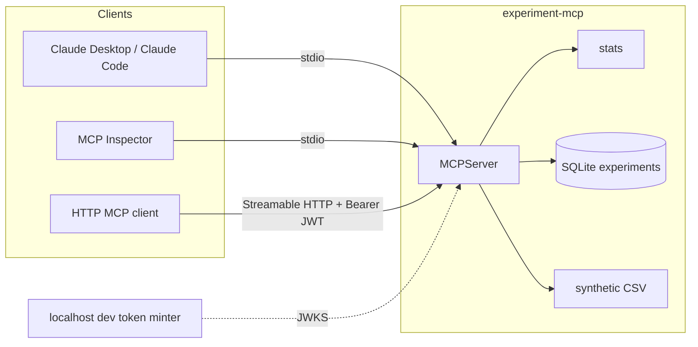

# experiment-mcp

An MCP server for designing and reading retail-offer experiments. It is a portfolio project: a small, offline, fully tested server that exercises the major Model Context Protocol features on synthetic offer data.

The statistics are ordinary two-sample calculations (sample size, hash assignment, lift with an optional CUPED adjustment, a chi-square sample-ratio check, and a percentile bootstrap). They are not a production experimentation platform, and the bundled rows are not real customers.

## Architecture



`src/experiment_mcp/stats/` has no MCP imports. `server.py` is the protocol layer: tools, resources, prompts, completions, sampling, and elicitation.

The SDK is `mcp` 2.x. `FastMCP` was renamed to `MCPServer`; this project uses that decorator API (`@mcp.tool`, `@mcp.resource`, `@mcp.prompt`, `@mcp.completion`).

## Why MCP instead of a plain API?

The calculations live in ordinary Python functions. MCP is the contract a model client uses to find and call them.

One server definition is enough for Claude Desktop, Claude Code, Cursor, and MCP Inspector. Each new client is configuration. Each new tool is one function. A hand-written function-calling adapter is per client, so N clients and M operations become N times M wrappers instead of N plus M.

Clients discover tools, resources, and prompts at runtime, with schemas generated from the function signatures. `close_experiment` can ask the user to confirm mid-call. `draft_readout` asks the client model to write prose, so this process has no model API key. Bootstrap `analyze_lift` reports progress. Creating or closing an experiment notifies subscribers. Resources and prompts are context, not just actions. `readOnlyHint` and `destructiveHint` are client hints. On HTTP, `experiments:read` and `experiments:write` are enforced per tool.

A plain HTTP call is the better fit when no model is involved, when a single request/response is enough, or when the extra session and protocol machinery is not worth it. MCP does not replace ordinary API review. The comparison, including a schema side by side, is in [docs/mcp-vs-api.md](docs/mcp-vs-api.md). A short click-through is in [docs/demo.md](docs/demo.md). How a call is dispatched, where the process runs, and how writes are gated is in [docs/design-faq.md](docs/design-faq.md).

## Feature matrix

| MCP feature | Where |
| --- | --- |
| Tools with pydantic input validation and structured output | `power_calc`, `assign_cells`, `analyze_lift`, `check_srm`, `list_experiments`, `create_experiment`, `close_experiment`, `draft_readout` |
| Tool annotations | `readOnlyHint` on compute tools; `destructiveHint` on `close_experiment` |
| Static resources | `dataset://schema`, `dataset://summary`, `experiment://index` |
| Resource templates | `experiment://{experiment_id}`, `experiment://{experiment_id}/results` |
| List-changed and resource-updated notifications | `create_experiment` and `close_experiment` publish on the subscription bus and the legacy notification methods |
| Prompts | `design_experiment`, `write_readout` |
| Completions | prompt arguments `metric`, `population`, `audience`, `experiment_id`, and the experiment resource templates |
| Sampling | `draft_readout` returns `Sample(...)` when the client declares sampling |
| Sampling fallback | same tool returns a template when the client does not |
| Elicitation | `close_experiment` asks the user to confirm before it writes |
| Elicitation fallback | if the client cannot ask, the record stays open until the call is repeated with `confirm=true` |
| Progress | bootstrap `analyze_lift` reports replicate counts |
| Logging | the same tool writes Python logs and deprecated MCP `notifications/message` entries |
| Cancellation | the bootstrap loop checks for a cancel signal between batches and awaits, so a cancelled call stops |
| stdio | `experiment-mcp serve` |
| Streamable HTTP | `experiment-mcp serve --transport http` |
| OAuth 2.1 resource server | bearer JWT validation, `WWW-Authenticate`, protected-resource metadata |
| Scopes | `experiments:read` and `experiments:write` checked per tool |

## Data

`src/experiment_mcp/data/synthetic/` is generated by `python -m experiment_mcp.synthetic` with seed `20261102`. `metadata.json` and `SYNTHETIC.md` label it as synthetic. The generator plants a redemption-probability gap and a spend shift so the tools have a deterministic file to read. Those planted settings are simulation inputs, not measured lift.

The tables are `customers.csv` (segment, region, pre-period spend) and `exposures.csv` (offer `WEEKEND_15`, arm, redeemed, post-period spend). Assignment uses the same salted hash as `assign_cells`.

### Optional: dunnhumby The Complete Journey

This server does not download that dataset. If you already have a local copy and accept dunnhumby's terms, a rough mapping onto these columns is:

- customer id and any segment fields you derive, plus a pre-period spend sum, become `customers.csv`
- campaign exposure, a redemption flag, and spend during the campaign window become `exposures.csv`

Point the server at that directory with `--data-dir` only after you add a `metadata.json` whose `origin` is honest about the source. The committed path stays synthetic.

## Quickstart

Requires Python 3.12 and [uv](https://docs.astral.sh/uv/).

```bash
uv sync
uv run experiment-mcp serve
```

That is stdio. It does not check a token. The security boundary is the process that launched it. The SQLite file defaults to `.experiment_mcp/experiments.db` in the working directory.

### Claude Desktop

```json
{
  "mcpServers": {
    "experiment-mcp": {
      "command": "uv",
      "args": [
        "--directory",
        "/absolute/path/to/experiment-mcp",
        "run",
        "experiment-mcp",
        "serve"
      ]
    }
  }
}
```

### Claude Code

```bash
claude mcp add experiment-mcp -- uv --directory /absolute/path/to/experiment-mcp run experiment-mcp serve
```

### Streamable HTTP and auth

HTTP is an OAuth 2.1 resource server. It validates bearer tokens. It does not sign users in. A token must be an RS256 JWT whose `iss`, `aud`, and `exp` match the server, and whose `scope` string contains the scopes for the tool you call.

`experiments:read` covers the compute and list tools. `experiments:write` is required to create or close an experiment, and it also allows read tools. Protected-resource metadata advertises both. The SDK's `required_scopes` list is applied to every HTTP request, so this server leaves that list empty and enforces the split inside each tool. Unauthenticated calls get `401` with a `resource_metadata` pointer.

Local token minter (loopback only, not a production identity provider, no end-user login):

```bash
uv run experiment-mcp dev-auth
```

It prints a dev secret and the JWKS URL. In another shell:

```bash
export EXPERIMENT_MCP_ISSUER_URL=http://127.0.0.1:9000
export EXPERIMENT_MCP_RESOURCE_URL=http://127.0.0.1:8000/mcp
export EXPERIMENT_MCP_JWKS_URL=http://127.0.0.1:9000/.well-known/jwks.json
uv run experiment-mcp serve --transport http --host 127.0.0.1 --port 8000
```

Mint a token. The dev secret is the `Authorization` value on this request. It is not the access token.

```bash
curl -s -X POST http://127.0.0.1:9000/token \
  -H "Authorization: Bearer $EXPERIMENT_MCP_DEV_AUTH_SECRET" \
  -H "Content-Type: application/json" \
  -d '{"resource":"http://127.0.0.1:8000/mcp","scope":"experiments:read experiments:write","sub":"local-dev"}'
```

`aud` / `resource` must be exactly `EXPERIMENT_MCP_RESOURCE_URL`. Issuer and resource URLs must be `https` unless the host is loopback.

Offline alternative, no dev server: `experiment-mcp mint-token` writes a private key (mode `0600`) and a JWKS file, prints one JWT, and you set `EXPERIMENT_MCP_JWKS_PATH` instead of `EXPERIMENT_MCP_JWKS_URL`.

`EXPERIMENT_MCP_ALLOW_INSECURE_NO_AUTH=1` starts HTTP with no token check. The process logs a warning. Do not expose that process. It cannot be combined with issuer or JWKS settings.

DNS rebinding protection is on. Extra `Host` and `Origin` values go in `EXPERIMENT_MCP_ALLOWED_HOSTS` and `EXPERIMENT_MCP_ALLOWED_ORIGINS` (comma-separated). Binding `0.0.0.0` is allowed for a container; add the public host to the allow list.

### MCP Inspector

```bash
uv run --with "mcp[cli]" mcp dev src/experiment_mcp/app.py:mcp
```

Or point the Inspector at the stdio command `uv run experiment-mcp serve`. For HTTP, connect to `http://127.0.0.1:8000/mcp` and paste a bearer token from the minter.

### Docker

The image listens on port 8000 and exits unless the auth environment variables above are set (or insecure mode is set explicitly). The database path inside the image is `/data/experiments.db`.

```bash
docker build -t experiment-mcp .
docker run --rm -p 8000:8000 \
  -e EXPERIMENT_MCP_ISSUER_URL \
  -e EXPERIMENT_MCP_RESOURCE_URL \
  -e EXPERIMENT_MCP_JWKS_URL \
  -e EXPERIMENT_MCP_ALLOWED_HOSTS \
  experiment-mcp
```

## Example conversation

The numbers below are one seeded synthetic draw (`seed` 20261102, offer `WEEKEND_15`). They are rounded. They are not a real incrementality result. The generator's planted redemption probabilities are 0.08 and 0.12, plus a 0.01 nudge when pre-period spend is above the median, so an estimate near a 4 point gap is what that draw should look like.

User: How many people per arm do I need to see a 2 point redemption lift from a 10% baseline?

Assistant calls `power_calc` with `metric=proportion`, `baseline=0.1`, `mde=0.02`. The normal approximation returns **3841 per arm** at alpha 0.05 and 80% power, equal allocation, two-sided. That formula does not account for peeking or extra metrics.

User: What happened on the synthetic weekend offer?

Assistant calls `analyze_lift` with `offer_id=WEEKEND_15` and `outcome=redeemed`. On this file the control redemption rate is about **8.83%** (n=2016) and treatment is about **13.16%** (n=1984). Absolute lift is about **+4.33 percentage points** (95% CI about **+2.39 to +6.26**). Relative lift is about **+49%**. CUPED on pre-period spend barely moves that interval here, because the covariate is only weakly related to the binary outcome in this draw.

The same call with `outcome=post_spend` gives control mean spend about **21.09** and treatment about **23.45**, absolute lift about **+2.36** (95% CI about **+2.01 to +2.71**). With CUPED, theta is about **0.51** and the interval tightens to about **+2.32 to +2.69**.

User: Write that up and close the experiment.

Assistant calls `create_experiment`, reads `experiment://{id}/results`, then `draft_readout`. If the client supports sampling, the client's model writes the prose from those facts. If it does not, the tool returns a template that repeats the facts and adds none. `close_experiment` then asks the user to confirm. Declining leaves the record running.

## Tools, briefly

- `power_calc` solves for per-arm sample size or absolute MDE. Proportions use an unpooled two-sample normal formula. Means use a known common sigma. Equal allocation, two-sided, no continuity correction.
- `assign_cells` maps `SHA-256(salt + 0x1f + unit_id)` into named weights. Arm order is alphabetical. The same salt and id always get the same arm.
- `analyze_lift` reads the synthetic offer or raw arrays. The interval is a normal approximation from each arm's sample variance, or a percentile bootstrap (100 to 10,000 replicates) with progress reports. CUPED uses one pooled theta.
- `check_srm` is a chi-square goodness of fit. The default alpha is 0.001. A mismatch is evidence against the intended weights, not a diagnosis.
- `create_experiment`, `list_experiments`, `close_experiment` are the SQLite record. Closing is destructive and idempotent once closed.

## Evals

`evals/tasks.json` is a small set of natural-language tasks with the tool call they should produce. `evals/recorded.json` is the recorded call for each task. Offline mode does not call a model:

```bash
uv run python -m experiment_mcp.evals
```

It checks that every recorded call matches the expected tool and arguments, then runs those calls in-process. CI runs this.

Live mode is optional and off by default. It sends each task to an API and scores the tool the model picks. It needs `EXPERIMENT_MCP_EVAL_API_KEY`, `EXPERIMENT_MCP_EVAL_MODEL`, and `EXPERIMENT_MCP_EVAL_PROVIDER` (`anthropic` or `openai`).

```bash
EXPERIMENT_MCP_EVAL_PROVIDER=anthropic \
EXPERIMENT_MCP_EVAL_MODEL=claude-sonnet-4-5 \
EXPERIMENT_MCP_EVAL_API_KEY=... \
uv run python -m experiment_mcp.evals --live
```

Offline success does not measure a model. Live success depends on the model and is not claimed here.

## Development

```bash
uv sync
uv run ruff check .
uv run ruff format --check .
uv run mypy
uv run pytest
uv run python -m experiment_mcp.evals
```

GitHub Actions runs the same steps.

Regenerate the synthetic files with `uv run python -m experiment_mcp.synthetic`. Review the diff. Do not treat a regenerated file as new evidence.

## Design decisions and limitations

- The HTTP server validates tokens and publishes protected-resource metadata. The dev minter is a separate localhost process with a shared secret. It is not an authorization-code server and must not be deployed as one.
- `confirm=true` on `close_experiment` is the fallback when elicitation is unavailable. A client can set it without showing a person a form. Treat that as an explicit confirmation from whoever is driving the client, not as a second factor.
- Sampling and MCP logging are deprecated as of the 2026-07-28 spec (SEP-2577). `draft_readout` still uses sampling when the client offers it, and otherwise returns the template. Logs always go to the Python logger. Protocol log notifications are still sent for clients that opt in, and they may warn.
- Lift is a difference in means. There is no sequential testing, no multiple-comparison adjustment, and no CUPED beyond the linear pooled adjustment. Bootstrap intervals are percentiles, not BCa. Relative intervals use the delta method, or bootstrap percentiles when that method is selected.
- Two arms are analyzed at a time. Assignment can name more than two arms.
- SQLite is a single local file. There is no multi-replica subscription bus.
- stdio does not authenticate. Do not point it at a dataset you would not hand to the desktop app.
- The example figures above are from the committed synthetic generator. They will change if the seed or the generator changes. They are not a benchmark against a public study.
